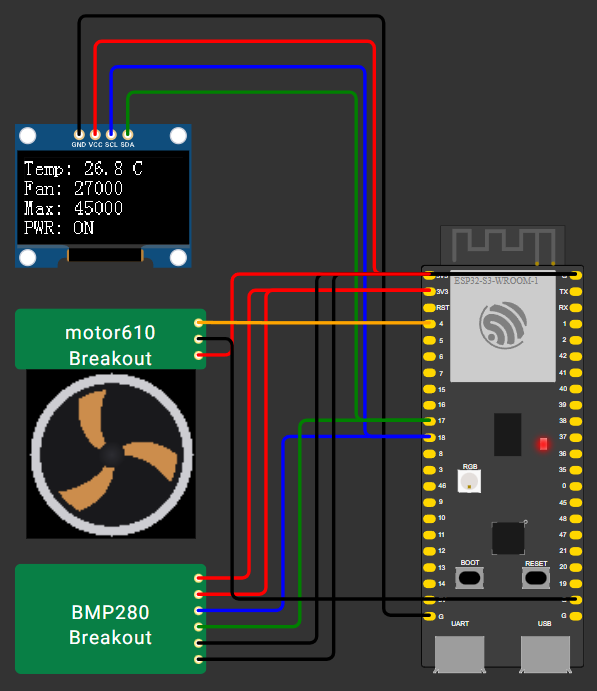
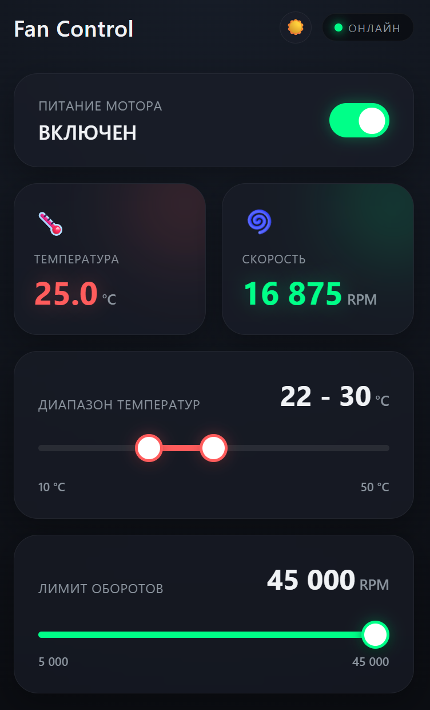

# 📟 Heltec WiFi LoRa 32 V4 — GY-BMP280 + OLED + 2 микромотора (MX1508 / DRV8837) + Пельтье TEC1-12706 + Wi-Fi дашборд

<p align="center">
  
</p>

<p align="center">
  
  
  
  
</p>

Прошивка на **ESP-IDF** для платы **Heltec WiFi LoRa 32 V4**: измеряет температуру элемента Пельтье датчиком **BMP280**, выводит состояние на **OLED-дисплей SSD1306** и PID-регулятором управляет скоростью двух микромоторов с пропеллерами (обдув горячей стороны Пельтье) через драйвер **MX1508** или **DRV8837** по ШИМ. Целевая температура и максимальные обороты задаются через **Wi-Fi веб-дашборд**. Проект собирается через **VS Code + PlatformIO** и симулируется в **Wokwi**.

---

## 📋 Содержание

1. [Возможности](#-возможности)
2. [Схема подключения](#-схема-подключения)
3. [Веб-дашборд](#-веб-дашборд)
4. [Настройка PlatformIO](#1-настройка-platformio)
5. [Настройка Wokwi](#2-настройка-wokwi)
6. [Сборка и загрузка](#3-сборка-и-загрузка)
7. [Возникают ошибки?](#-возникают-ошибки)

---

## ✨ Возможности

- Чтение температуры элемента Пельтье с **GY-BMP280-3.3V** по I2C
- Вывод текущей и целевой температуры, скорости пропеллеров и состояния PID на **OLED SSD1306**
- Автоматическое PID-управление двумя микромоторами с пропеллерами через аппаратный ШИМ 20 кГц (драйвер MX1508 или 2×DRV8837 — выбирается одной строкой в `src/prop.h`)
- Защита моторов по напряжению: действующее напряжение на моторе никогда не превышает 4,2 В, даже при питании 5 В
- Настраиваемая уставка температуры в диапазоне **10–50 °C**
- Аварийный максимальный обдув при потере связи с датчиком температуры
- Опрос датчика каждые **100 мс** — показания в дашборде и на OLED обновляются практически мгновенно
- Управление системой через **Wi-Fi веб-дашборд**
- Полная симуляция в **Wokwi**, включая доступ к дашборду через проброс порта
- Светлая/тёмная тема интерфейса дашборда

---

## 🔌 Схема подключения

### Модули (характеристики — в [`docs/specs.txt`](docs/specs.txt))

| Модуль | Роль | Питание | Ключевое |
|---|---|---|---|
| GY-BMP280-3.3V | датчик температуры Пельтье | 3,3 В (от 3V3 платы) | I2C/SPI, −40…+85 °C |
| MX1508 | драйвер двух моторов (по умолчанию) | 2–10 В (аккумулятор 1S) | 2 канала, 1,5 А (пик 2,5 А), IN1–IN4 |
| DRV8837 ×2 | альтернативный драйвер (по одному на мотор) | VM 0–11 В, VCC 1,8–7 В | 1,8 А пик, IN1/IN2 + nSLEEP |
| Микромоторы 6×15 мм ×2 | обдув с разнонаправленными пропеллерами | ≤ 4,2 В | 46 500 об/мин, см. [`micro_motors.md`](micro_motors.md) |
| Пельтье TEC1-12706 | охлаждаемый элемент | **12 В, 4,3–4,6 А** (отдельный БП) | 55 Вт, пуск до 5,8 А |

### Сигналы ESP32-S3

| Сигнал | Pin ESP32-S3 | OLED SSD1306 | GY-BMP280 | MX1508 | DRV8837 №1 | DRV8837 №2 |
|--------|:---:|:---:|:---:|:---:|:---:|:---:|
| SDA    | GPIO17 | SDA | SDA | — | — | — |
| SCL    | GPIO18 | SCL | SCL | — | — | — |
| 3V3    | 3V3    | VCC | VCC, CSB | — | VCC | VCC |
| GND    | GND    | GND | GND, SDO | GND | GND | GND |
| Reset  | GPIO21 | RST | — | — | — | — |
| VEXT   | GPIO36 | питание платы | — | — | — | — |
| Мотор 1, вход 1 (ШИМ) | GPIO4 | — | — | IN1 | IN1 | — |
| Мотор 1, вход 2 | GPIO5 | — | — | IN2 | IN2 | — |
| Мотор 2, вход 1 (ШИМ) | GPIO6 | — | — | IN3 | — | IN1 |
| Мотор 2, вход 2 | GPIO7 | — | — | IN4 | — | IN2 |
| nSLEEP (только DRV8837) | GPIO2 | — | — | — | nSLEEP | nSLEEP |

> Пины выбраны среди свободных выводов платы (GPIO2, 4–7). Если на вашей ревизии платы какой-то из них занят, измените `PROP_*_PIN` в [`src/prop.h`](src/prop.h).

### Питание (важно!)

```
Аккумулятор 1S (3,7–4,2 В) ──► VCC MX1508  (или VM обоих DRV8837)
                     └─ GND ──┬──► GND MX1508 / DRV8837
                              └──► GND ESP32      ◄── общая земля обязательна
ESP32 3V3 ──► VCC (логика) DRV8837, VCC GY-BMP280, VCC OLED
БП 12 В (≥ 6 А) ──► красный провод Пельтье;  «−» БП ──► чёрный провод + общая GND
```

- **MX1508**: питание модуля 2–10 В и моторы берутся с одной линии. Подключайте отдельный аккумулятор/БП и **обязательно соедините его минус с GND ESP32**.
- **DRV8837**: не подавайте VM без VCC — это может вывести чип из строя. VCC питайте от 3V3 платы, VM — от аккумулятора. Выводы nSLEEP обоих модулей соединяются вместе и идут на GPIO2 (HIGH = работа, LOW = сон 120 нА); прошивка сама усыпляет драйверы, когда моторы выключены.
- **Пельтье** питается только от отдельного блока 12 В с запасом по току (≥ 6 А, пуск до 5,8 А). **Ни MX1508, ни DRV8837 для него не подходят**: ток 4,3–4,6 А против 1,5 А (пик 2,5 А) и 1,8 А (пик) у драйверов. Пельтье обязательно ставится на радиатор — без теплоотвода горячая сторона быстро перегреется. В этой схеме Пельтье включён постоянно и прошивкой не коммутируется.
- В Wokwi чип Пельтье подключён к 3V3/GND только для визуализации; симулятор не моделирует ток нагрузки и теплоперенос.

> `SDO → GND` задаёт I2C-адрес BMP280 `0x76`; при `SDO → VCC` адрес будет `0x77`. Модуль GY-BMP280-3.3V рассчитан на 3,3 В — не подключайте VCC к 5 В.

> BMP280 в этой схеме считается датчиком температуры элемента Пельтье и должен иметь хороший тепловой контакт с контролируемой поверхностью. Диапазон датчика −40…+85 °C: не допускайте нагрева датчика выше +85 °C. Для реального устройства обычно удобнее контактный датчик вроде DS18B20 или NTC-термистора.

> **Про производительность обдува.** Два микромотора дают тягу всего 11–12 г каждый (при 3,7 В) — этого достаточно для небольшого радиатора, но мало для охлаждения горячей стороны Пельтье 55 Вт на полной мощности. Для реального устройства питайте Пельтье пониженным напряжением (например, 5–6 В, ~2 А) или используйте более мощный вентилятор (тогда в `src/prop.h` понадобится другой драйвер).

### Выбор драйвера и настройки моторов — `src/prop.h`

| Параметр | Назначение | По умолчанию |
|---|---|---|
| `PROP_DRIVER` | `PROP_DRIVER_MX1508` (один модуль на оба мотора) или `PROP_DRIVER_DRV8837` (два модуля + nSLEEP) | MX1508 |
| `PROP_SUPPLY_V` | напряжение питания моторов; при > 4,2 В скважность автоматически ограничивается | 4.2 |
| `PROP_A_REVERSED`, `PROP_B_REVERSED` | поменять направление вращения мотора (ШИМ на IN2/IN4 вместо IN1/IN3) | 0 |
| `PROP_MIN_RUN_RPM` | минимальные обороты запуска микромоторов | 4000 |
| `PROP_*_PIN` | назначение выводов | GPIO4/5/6/7, nSLEEP — GPIO2 |

Пропеллеры в комплекте разнонаправленные: ставьте каждый на «свой» мотор и убедитесь, что оба дуют в одну сторону. Если один дует в обратную — поменяйте провода этого мотора местами или переключите его флаг `PROP_x_REVERSED`.

### PID-регулятор обдува

Регулятор выполняется каждые **100 мс**. Ошибка рассчитывается как `текущая температура − целевая температура`: чем сильнее перегрет элемент, тем выше требуемые обороты. Используются коэффициенты `Kp = 7000`, `Ki = 600`, `Kd = 1500`; выход ограничивается пользовательским лимитом оборотов (до 46 500 об/мин — максимум микромоторов при 4,2 В). Обороты ниже порога запуска микромоторов (`PROP_MIN_RUN_RPM`) поднимаются до него, а совсем малые команды выключают моторы. Условное интегрирование останавливает накопление интегральной составляющей в сторону насыщения и позволяет ей уменьшаться после смены температуры.

---

## 🌐 Веб-дашборд

<p align="center">
  
</p>

При старте прошивка поднимает Wi-Fi в режиме **AP+STA** и веб-сервер (HTTP + WebSocket) с дашбордом:

- **Точка доступа (AP)**: SSID `Heltec_ESP32`, пароль `12345678` — работает как в симуляции, так и на реальном железе.
- **Станция (STA)**: плата также пытается подключиться к сети `Wokwi-GUEST` — это виртуальная сеть, которую Wokwi предоставляет только внутри симуляции.

**Адрес дашборда отличается** в симуляции и на реальном устройстве:

| Где | Пояснение | Адрес дашборда |
|---|---|---|
| Симуляция Wokwi | Порт пробрасывается через `wokwi.toml` (`localhost:8180` → `target:80`) | http://localhost:8180 |
| Реальное железо | Подключите устройство к Wi-Fi сети `Heltec_ESP32` (пароль `12345678`) | http://192.168.4.1 |

Возможности дашборда:

- Включение/выключение обдува (PID)
- Текущие температура элемента Пельтье и обороты в реальном времени (обновление по WebSocket)
- Лимит максимальных оборотов пропеллеров в диапазоне 5000–46500 об/мин
- Целевая температура PID-регулятора (по умолчанию 25 °C, регулируется в пределах 10–50 °C)
- Переключение светлой/тёмной темы интерфейса

> Все настройки, заданные через дашборд (лимит оборотов, целевая температура, питание), хранятся только в оперативной памяти платы и сбрасываются к значениям по умолчанию при перезагрузке.

---

## 1. настройка PlatformIO

Установите расширение **PlatformIO** через маркетплейс VS Code

`VS Code` → `Extensions` → `PlatformIO` → `Download`

Откройте терминал PlatformIO одним из способов

- `PlatformIO` → `Quick Access` → `Miscellaneous` → `New Terminal`
- `VS Code` → `Ctrl + Shift + P` → `PlatformIO: New Terminal`

Затем выполните команды

```bash
pio project init -b heltec_wifi_lora_32_V3 -O "framework=espidf"
pio pkg update
```

---

## 2. Настройка Wokwi

*Wokwi — расширение VS Code для симуляции платы без физического устройства*

Установите расширение **Wokwi** через маркетплейс VS Code

`VS Code` → `Extensions` → `Wokwi Simulator` → `Download`

Скомпилируйте файлы кастомных чипов

```bash
iwr https://wokwi.com/ci/install.ps1 -useb | iex
wokwi-cli chip compile bmp280.chip.c -o bmp280.chip.wasm
wokwi-cli chip compile mx1508.chip.c -o mx1508.chip.wasm
wokwi-cli chip compile peltier.chip.c -o peltier.chip.wasm
```

Параметры симуляции задаются в `diagram.json`.

Для чипа `chip-bmp280`:

| Параметр | Назначение | По умолчанию |
|---|---|---|
| `temperature` | температура, которую «видит» датчик, °C — задаётся вручную слайдером на самом чипе в Wokwi | 25 (диапазон слайдера: −40…85, как у реального датчика) |
| `updateIntervalMs` | как часто чип перечитывает положение слайдера и обновляет регистры данных, мс | 100 |

> Температура выставляется вручную слайдером `Temperature (°C)` во время симуляции — кликните по чипу BMP280 в Wokwi, чтобы открыть панель управления.

> Wokwi не моделирует теплоперенос между пропеллерами и Пельтье. Поэтому для проверки PID вручную изменяйте температуру BMP280: выше уставки обороты увеличиваются, ниже уставки — уменьшаются. На реальном устройстве обратную связь обеспечивает физический датчик на элементе Пельтье.

Для чипа `chip-mx1508` (модуль MX1508 + два микромотора с пропеллерами; левый вращается по часовой, правый — против):

| Параметр | Назначение | По умолчанию |
|---|---|---|
| `supplyV` | напряжение питания моторов, В — задаётся слайдером `Motor supply (V)` на самом чипе | 4.2 (диапазон слайдера 2–10) |
| `smoothingMs` | сглаживание изменения скорости (инерция ротора), мс | 250 |

> Обороты в симуляции считаются как `46500 × (скважность × Vпитания) / 4,2`. Если действующее напряжение на моторе выше 4,2 В, ступица пропеллера краснеет (перенапряжение). Прошивка этого не допускает: при `PROP_SUPPLY_V 5.0f` она сама ограничивает скважность. Синий цвет лопастей означает вращение мотора в обратную сторону. Если нет питания на пине `VCC` модуля, пропеллеры стоят.

> Лимит оборотов задаётся переменной `prop_max_rpm` и меняется через [веб-дашборд](#-веб-дашборд) — работает как в симуляции, так и на реальном железе. Значение не сохраняется между перезагрузками платы. Симуляция моделирует модуль MX1508; вариант с двумя DRV8837 в Wokwi не моделируется (логика ШИМ та же, добавляется только сигнал nSLEEP).

---

## 3. Сборка и загрузка

Финальный шаг — собрать и загрузить проект

**`Build`** → **`Upload`**

> Смотреть логи можно через `Serial Monitor` (Ctrl+Alt+S)

✅ Готово

---

## 🛠️ Возникают ошибки?

Удалите артефакты сборки и повторите сборку заново

- `.pio`
- `.vscode`
- `managed_components`
- `sdkconfig.heltec_wifi_lora_32_V3`

```bash
pio run -t clean
```

